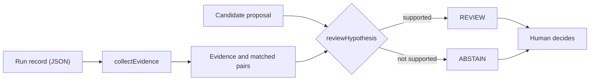

# incident-triage-evidence-gate

Runnable demonstration of evidence validation, safe abstention, and human-in-the-loop incident triage.

A dependency-free Node.js example of how to put a deterministic gate between a proposed explanation for a failure and the people who act on it. All data is synthetic.

## Why a passing retry is not an answer

A browser end-to-end test times out waiting for a dashboard. CI retries it, the retry passes, and the failure gets filed as flaky.

A passing retry only tells you that the second attempt worked. It says nothing about why the first one failed. A service that returns HTTP 500 for a fraction of login requests will also pass most retries. If the first attempt failed because of a real, intermittent server-side error, the retry hides it, and the same problem comes back later in a less convenient place.

The opposite mistake is just as easy. Telemetry from the same minute is not telemetry from the same request. An error logged by another request, or by an unrelated service, at the same instant can make a story look better supported than it is.

This project shows one way to handle both problems: collect the evidence, let something propose an interpretation, verify what can be verified with ordinary code, and hand the result to a person together with an honest statement of how much it supports.

## What this project demonstrates

An investigation is split into five steps, each with a different owner:

| Step | What happens | Where it lives |
| --- | --- | --- |
| 1. Evidence collection | Pull the failing HTTP responses and service log entries out of a run record. | `collectEvidence`, `matchingPairs` |
| 2. Candidate interpretation | Something proposes a claim, its scope, the evidence IDs it relies on, and a next action. Here the proposal is prewritten; in a fuller system a model could produce it. | `defaultCandidate`, `fixtures/proposals/` |
| 3. Deterministic evidence verification | Check that every cited ID is a real, unambiguous event belonging to a response/log pair that shares a request ID and trace ID. | `reviewHypothesis` |
| 4. Policy checks | Check that the claim type, claim scope and next action are on a fixed allowlist. | `reviewHypothesis`, `POLICY` |
| 5. Human decision | Every result, including a supported one, is marked as requiring human review. The code takes no action. | `humanReviewRequired` in the result |

The gate returns one of two outcomes:

- `REVIEW`: the evidence supports looking into the auth service. It does not establish a root cause and it does not say how many users were affected.
- `ABSTAIN`: the proposal is missing, malformed, outside policy, or not supported by the evidence. It does not mean the service is healthy.

## Architecture



The candidate proposal is the only box that could be a model. Everything else is ordinary, deterministic code.

| Component | Role |
| --- | --- |
| `src/core.cjs` | The gate. Collects evidence, correlates events, validates a proposal, renders a Markdown report. No dependencies, no I/O. |
| `src/triage.mjs` | Command-line wrapper. Loads a fixture, runs the gate, prints the result. |
| `fixtures/scenarios/` | Synthetic run records: one failed test attempt, its HTTP responses and service logs, and the retry result. |
| `fixtures/proposals/` | Hand-written proposals that a model might plausibly produce, used to exercise the policy and citation checks. |
| `test/` | Unit tests for the gate and tests for the command line. |

## Quick start

Requires Node.js 22 or newer. Tested on Node.js 22; other versions have not been independently checked. There is nothing to install.

From the root of the repository:

```bash
npm test
npm run demo
```

If you do not have npm, the same commands are:

```bash
node --test test/triage.test.mjs test/cli.test.mjs
node src/triage.mjs --all
```

`npm run demo` runs every scenario with the prewritten proposal, then runs the hand-written proposals against the matching scenario:

```text
Scenarios, each with the prewritten offline proposal:
matched_request      REVIEW   Request-matched login HTTP 5xx and auth ERROR justify service investigation, not root-cause confirmation
missing_telemetry    ABSTAIN  No auth-service ERROR was observed to corroborate the login HTTP 5xx
retry_only           ABSTAIN  No qualifying login HTTP 5xx or auth-service ERROR evidence was observed
wrong_request        ABSTAIN  Login HTTP 5xx and auth errors have no matching request/trace identity within the time window
wrong_service        ABSTAIN  No auth-service ERROR was observed to corroborate the login HTTP 5xx

Hand-written proposals, each against matched_request:
fabricated_citation  ABSTAIN  One or more cited evidence IDs are missing, duplicated or ambiguous
overconfident        ABSTAIN  Claim type or scope exceeds the supported investigation; Proposed action is outside the investigation-only allowlist
```

Run a single scenario for a fuller view:

```bash
node src/triage.mjs matched_request
```

```text
Scenario     : Two login failures, corresponding errors in the same request and trace
Run          : CI-1042: first attempt failed, retry passed
Evidence     : 2 login 5xx, 2 auth-api ERROR, 2 request-and-trace matched pair(s)
Proposal     : possible_service_side_login_failure (scope investigation_only) -> inspect_auth_service
Cited IDs    : resp-1, log-1
Outcome      : REVIEW
Reason       : Request-matched login HTTP 5xx and auth ERROR justify service investigation, not root-cause confirmation
Verified IDs : resp-1, log-1
Next step    : Inspect auth-service health, trace context and deployment history
Human review : required

No live model call. The proposal is an offline synthetic candidate.
```

```bash
node src/triage.mjs wrong_request
```

```text
Scenario     : Same timestamp and auth service, but different request and trace identifiers
Run          : CI-1044: first attempt failed, retry passed
Evidence     : 1 login 5xx, 1 auth-api ERROR, 0 request-and-trace matched pair(s)
Proposal     : possible_service_side_login_failure (scope investigation_only) -> inspect_auth_service
Cited IDs    : none
Outcome      : ABSTAIN
Reason       : Login HTTP 5xx and auth errors have no matching request/trace identity within the time window
Verified IDs : none
Next step    : Collect or inspect missing evidence
Human review : required

No live model call. The proposal is an offline synthetic candidate.
```

Other options:

```bash
node src/triage.mjs matched_request --proposal overconfident   # validate a hand-written proposal
node src/triage.mjs matched_request --report                   # print a Markdown report
node src/triage.mjs --help
```

No live model is called, nothing is written to disk, and nothing touches the network.

## Scenarios

The scenarios are files in `fixtures/scenarios/`. Each one is run with the prewritten proposal.

| Scenario | What the evidence looks like | Outcome | Why |
| --- | --- | --- | --- |
| `matched_request` | Two `POST /api/internal/login` responses with HTTP 500. Each has an `auth-api` ERROR log with the same request ID and trace ID, within two seconds. The retry passed. | `REVIEW` | The cited response and log form a verified pair. That supports inspecting the auth service. It does not show why the service failed. |
| `wrong_request` | One login 500 and one `auth-api` ERROR about one millisecond apart, but with different request and trace IDs. | `ABSTAIN` | The timing matches and the service matches, but the identities do not. The error belongs to some other request. |
| `retry_only` | The only recorded response is `GET /dashboard` with HTTP 200, and there are no service logs. The retry passed. | `ABSTAIN` | There is no qualifying login failure and no corroborating error. The passing retry adds nothing, and the decision is the same whether the retry passed or not. |
| `missing_telemetry` | One login 500, no service logs. | `ABSTAIN` | There is a failure but nothing to corroborate it. Missing logs are missing evidence, not evidence of health. |
| `wrong_service` | One login 500 and an ERROR with the same request and trace ID, but from `email-worker`. | `ABSTAIN` | The log is not from the service the claim is about. |

Two hand-written proposals show what happens when the evidence is fine but the proposal is not. Both run against `matched_request`.

| Proposal | What it asks for | Outcome | Why |
| --- | --- | --- | --- |
| `overconfident` | Scope `all_customers_affected`, next action `rollback_production`. | `ABSTAIN` | The claim goes beyond what request-level evidence can support, and rolling back production is not on the allowlist. Both violations are reported. The evidence being valid does not rescue a proposal that overreaches. |
| `fabricated_citation` | A real, verified pair plus an ID, `log-made-up`, that does not exist in the telemetry. | `ABSTAIN` | Every cited ID must be real. One good pair cannot vouch for an invented one. |

The unit tests cover many more variations of the same ideas: duplicate IDs, half-matched pairs, unrelated but real events, malformed telemetry records, null and malformed proposals, and a Markdown report that must not be injectable.

## Engineering decisions

**Deterministic checks for verifiable evidence.** Whether an event ID exists, whether two events share a request ID and trace ID, and whether a cited ID belongs to a matched pair are questions with exact answers. Plain code answers them the same way every time, can be unit-tested, and cannot be talked into a different answer by persuasive text.

**Model-assisted interpretation is a separate responsibility.** Deciding what a pile of logs and traces might mean is where a model can help, and it is also where it can be wrong. The gate does not care where a proposal comes from. `evaluateRun(run, candidate)` validates exactly what it is given. `replayRun(run)` exists only as an explicitly named offline demonstration that builds a prewritten proposal and then runs the same validation. A missing or malformed proposal never falls back to the prewritten one; it abstains.

**Consistent request and trace identity.** Two events that happen at about the same time are not necessarily related. Under load, many requests overlap. Requiring the same request ID and the same trace ID makes timestamps a secondary check rather than the main one, and `wrong_request` shows the failure this prevents. IDs must be non-empty strings of at most 128 characters, and timestamps must be ISO 8601 with an explicit offset, otherwise the event cannot take part in correlation. Time comparisons use JavaScript millisecond precision; submillisecond timestamp fractions are truncated.

**Unsupported citations are rejected.** A proposal must cite at least two evidence IDs, and every one must be a real event, unique in the telemetry, and part of a complete verified pair. One valid pair does not make an additional invented, unrelated or half-matched ID acceptable. The result contains only the IDs the gate verified, not the list the proposal supplied.

**Abstain when support is insufficient.** The gate explains why it abstained and distinguishes between "nothing relevant was observed" and "something was observed but could not be tied to this request". It never reads an absence of evidence as a sign that the service is fine.

**Unsafe remediation is not authorized.** The gate accepts one claim type, one claim scope and one next action, which is to inspect the auth service. Anything else abstains. The free-text `draftText` field in a proposal is never read, so persuasive or alarming prose cannot reach the trusted output; the result uses fixed wording instead. Untrusted values that do appear in the Markdown report are escaped.

**Humans keep authority over production changes.** `REVIEW` means "a person should look at this", not "do this". Every result sets `humanReviewRequired`. The code has no side effects: it makes no network calls, writes no files and executes nothing. This is a design choice, not a missing feature.

The gate is deliberately not a general-purpose semantic validator. A new kind of claim needs its own claim type and validation policy. Without one, it abstains or goes to a human.

## Limitations

- The proposals are prewritten and synthetic. No live LLM is called, so nothing here says anything about how well a model would perform.
- It does not generate fix pull requests, and it does not connect to an incident-management, paging, chat or observability system.
- It does not prove a root cause or that anything is safe in production. A `REVIEW` outcome means the evidence is worth a person's time, nothing more.
- The telemetry is invented. The record format is a small teaching schema, not a real telemetry schema, and this is not a telemetry ingestion pipeline.
- `traceArtifact` is only a reported path. The trace contents are never downloaded or parsed.
- The policy is narrow: one endpoint, one service, an HTTP 5xx plus an ERROR log, and a fixed two-second window. Clock skew between systems is not handled.
- Matching request and trace IDs make a log entry a candidate explanation, not a cause. Correlation is not causation.
- It is a teaching example, not a production agent.

A fuller system could use an LLM to propose interpretations from complex context such as logs, traces, deploys and runbooks. The idea this project illustrates is that such a proposal should pass through separate, deterministic controls before anyone acts on it.

## Possible extensions

None of these are implemented here.

- **A live model.** Ask a model for a proposal in the same structure the fixtures use and pass it to `evaluateRun`. The gate should stay unchanged, and rejected proposals are worth recording.
- **Structured telemetry.** Replace the fixture shape with real span and log records that carry trace and request IDs. The correlation rules should carry over; the field names will not.
- **A human review workflow.** Route `REVIEW` and `ABSTAIN` results to a queue, and record who decided what and why.
- **Evaluation against a rules-only baseline.** This project does not show that a model beats plain rules. To find out, compare both on previously unseen failures and measure human review time, wrong ownership, missed real issues, how often the system abstains, and what false alerts cost.

## Project layout

```text
.
├── .gitignore
├── fixtures
│   ├── proposals
│   │   ├── fabricated_citation.json
│   │   └── overconfident.json
│   └── scenarios
│       ├── matched_request.json
│       ├── missing_telemetry.json
│       ├── retry_only.json
│       ├── wrong_request.json
│       └── wrong_service.json
├── src
│   ├── core.cjs
│   └── triage.mjs
├── test
│   ├── cli.test.mjs
│   └── triage.test.mjs
├── package.json
├── LICENSE
└── README.md
```

## License

Licensed under the [MIT License](LICENSE).

## Disclaimer

All identifiers, timestamps and messages are synthetic. This project is not affiliated with or endorsed by any company or product.
